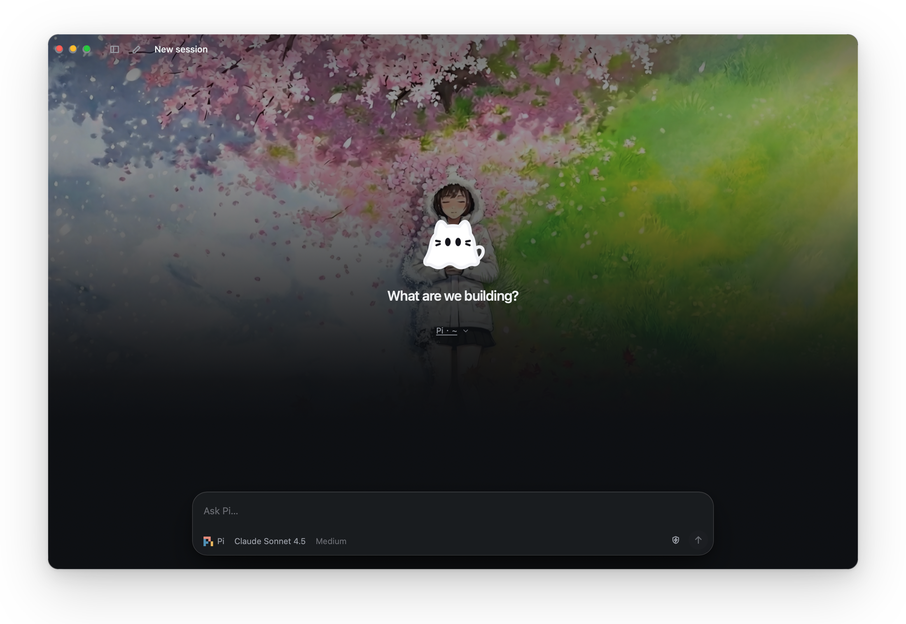
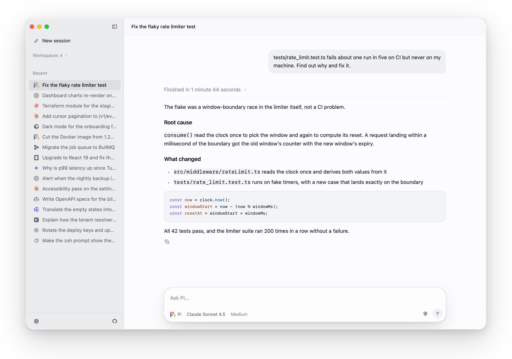
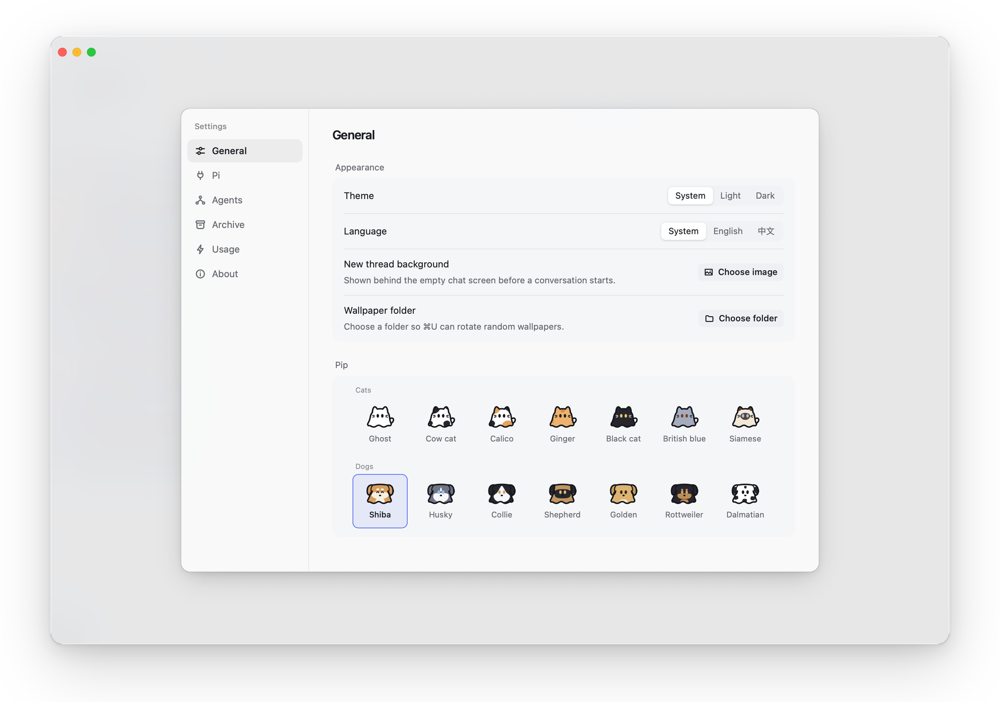

  
  <h1>pipi</h1>
  
<strong>A native desktop control surface for coding agents</strong>

  

    <strong>English</strong> · <a href="README.md">中文</a> · <a href="https://github.com/blueberrycongee/pipi/releases">Releases</a>
  

pipi is a cross-platform native desktop app (no Electron) that gathers the coding agents already installed on your machine into one window. Sign-ins, subscriptions, API keys, and session history all carry over. If an agent runs in your terminal, pipi can drive it.

## Highlights

- Built-in support for **18 coding agents**, plus any ACP-compatible command
- Parallel sessions: switching conversations never interrupts a running task
- Delegate sub-tasks by role to any installed agent to work in parallel
- Command palette (`⌘K` / `Ctrl+K`), slash commands, image paste, session archiving, usage stats, custom wallpapers
- pipi the mascot is cute, with 7 cat and 7 dog coats in Settings

<picture>
  <source media="(prefers-color-scheme: dark)" srcset="assets/promo/chat-dark.png">
  
</picture>

<picture>
  <source media="(prefers-color-scheme: dark)" srcset="assets/promo/settings-dark.png">
  
</picture>

## Download

Grab the latest build from [GitHub Releases](https://github.com/blueberrycongee/pipi/releases):

| Platform | Package | Requirements |
| --- | --- | --- |
| **macOS** (Apple Silicon) | `pipi-*-mac-arm64.dmg` | macOS 14+, signed and notarized |
| **Windows** (x64) | `pipi-*-windows-x64*.zip` / `setup.exe` | Windows 10 (1809)+; SmartScreen may ask for confirmation |
| **Linux** (x64) | `pipi-*-linux-x64.tar.gz` | GTK 4.14+ (Ubuntu 24.04 or newer) |

> Install at least one supported coding agent and sign in first (or add API keys in **Settings**); some agents require Node.js 22+.

## Supported Agents

pipi automatically discovers agents installed on your machine:

Pi · Claude Code · Codex · Devin · Cursor · OpenCode · Gemini CLI · GitHub Copilot · Kimi CLI · Qwen Code · DeepSeek Harness · Grok · Goose · Antigravity · Hermes · Kiro · Factory Droid · Amp · any ACP-compatible agent

## Feedback

Bugs and ideas welcome via [Issues](https://github.com/blueberrycongee/pipi/issues). Developers: see [AGENTS.md](AGENTS.md) and [DESIGN.md](DESIGN.md).
