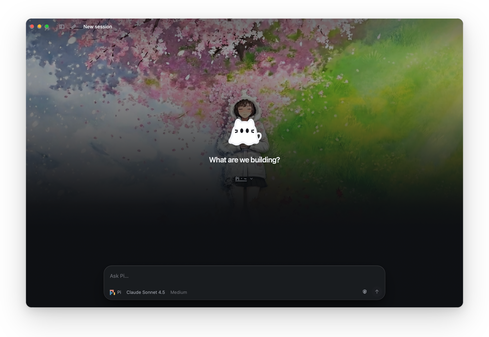
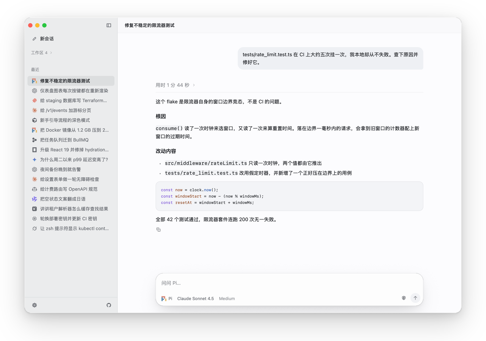
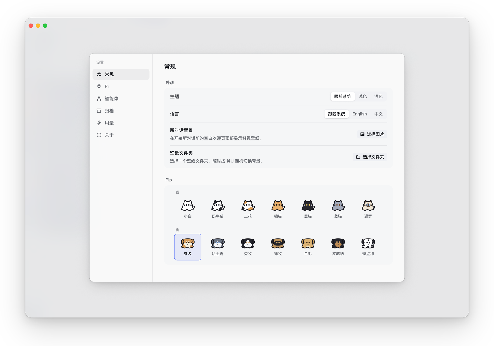

  
  <h1>pipi</h1>
  
<strong>为编码智能体打造的原生桌面控制台</strong>

  

    <a href="README.en.md">English</a> · <strong>中文</strong> · <a href="https://github.com/blueberrycongee/pipi/releases">下载安装包</a>
  

pipi 是一款跨平台原生桌面应用（不用 Electron），把电脑上已安装的编码智能体聚在一个窗口里。登录态、订阅、API 密钥和会话历史原样保留，终端里能用的，打开 pipi 就能用。

## 特性

- 内置支持 **18 种主流编码智能体**，也可添加任何 ACP 兼容命令
- 多会话并行：切换会话不打断运行中的任务，后台进度一目了然
- 可以把子任务按角色委派给本机任意智能体并行完成
- 命令面板（`⌘K` / `Ctrl+K`）、斜杠命令、图片粘贴、会话归档、用量统计、自定义壁纸
- 吉祥物 pipi 很可爱，设置里还能给它换 7 款猫咪和 7 款小狗皮肤

<picture>
  <source media="(prefers-color-scheme: dark)" srcset="assets/promo/chat-zh-dark.png">
  
</picture>

<picture>
  <source media="(prefers-color-scheme: dark)" srcset="assets/promo/settings-zh-dark.png">
  
</picture>

## 下载

前往 [GitHub Releases](https://github.com/blueberrycongee/pipi/releases) 下载：

| 平台 | 安装包 | 要求 |
| --- | --- | --- |
| **macOS** (Apple Silicon) | `pipi-*-mac-arm64.dmg` | macOS 14+，已签名公证 |
| **Windows** (x64) | `pipi-*-windows-x64*.zip` / `setup.exe` | Windows 10 (1809)+，首次运行如遇 SmartScreen 请确认运行 |
| **Linux** (x64) | `pipi-*-linux-x64.tar.gz` | GTK 4.14+（Ubuntu 24.04 及以上） |

> 使用前请确保本机已安装至少一个受支持的编码智能体并完成登录（或在 **设置** 中配置 API 密钥）；部分智能体需要 Node.js 22+。

## 支持的编码智能体

pipi 会自动发现本机已安装的智能体：

Pi · Claude Code · Codex · Devin · Cursor · OpenCode · Gemini CLI · GitHub Copilot · Kimi CLI · Qwen Code · DeepSeek Harness · Grok · Goose · Antigravity · Hermes · Kiro · Factory Droid · Amp · 其他 ACP 兼容智能体

## 反馈

欢迎通过 [Issues](https://github.com/blueberrycongee/pipi/issues) 提交 Bug 与建议。开发者请见 [AGENTS.md](AGENTS.md)（架构）与 [DESIGN.md](DESIGN.md)（设计）。
